# Визуальные графики: этапы, потоки, результат

Все схемы в Mermaid — открываются в VS Code (Markdown Preview) и на GitHub.
Нумерация — как в `plan.md` (этапы 0–9); группы в `tasks.md` идут 1–10 и в заголовке каждой указан номер этапа.

> **Актуальность (2026-11-03).** Схемы §10–§11 описывают механику `startOnLink`, которую PR #428 (`ca12e587e5`,
> ветка `FUSIO-1307-livekit-shared-link`) убрал из модели: статуса `Scheduled` нет, перезапуска завершённой
> встречи нет, ссылка — указатель на серию с `meetingAccess.start`. Читать их как историю решения; фактическое
> состояние — `audit-pr-428.md` §4.

## 1. Карта этапов и зависимостей

Что показывает: какие этапы можно вести параллельно, а какие ждут друг друга.

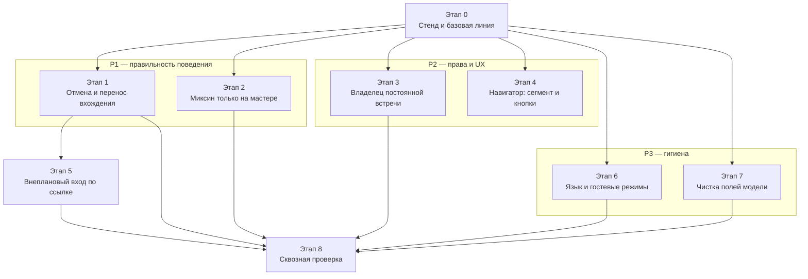

## 2. Что изменится для пользователя

Что показывает: конкретные симптомы «до» и «после», без внутренних деталей.

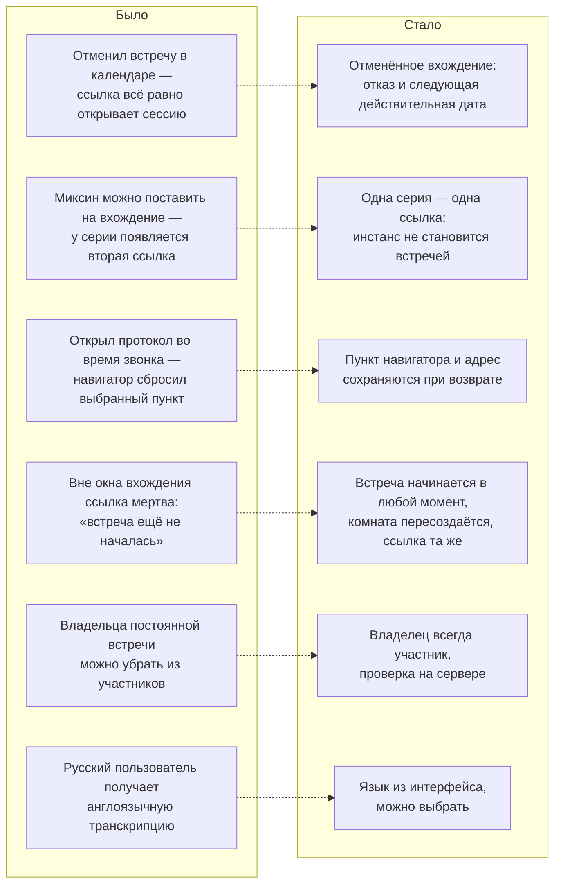

## 3. Порядок работ во времени

Что показывает: последовательность и относительную длительность при последовательном исполнении (календарь условный).

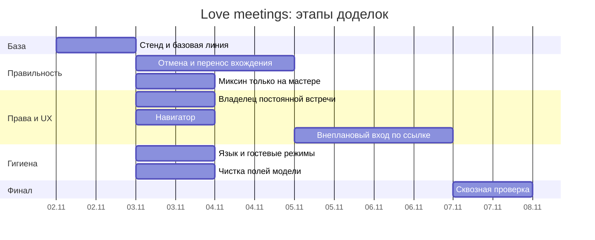

## 4. Как теперь резолвится гостевая ссылка

Что показывает: точка, куда встраивается этап 1 — переопределения вхождения читаются до расчёта окна.

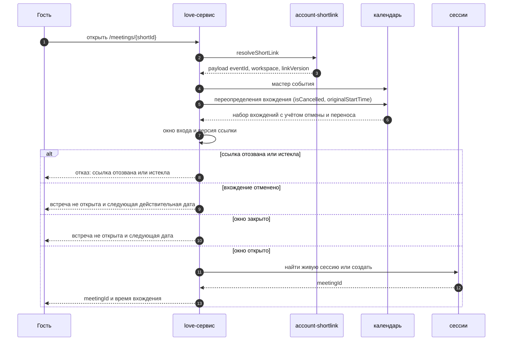

## 5. Жизненный цикл сессии

Что показывает: где именно действуют окно входа, терминальность завершения и повторный вход.

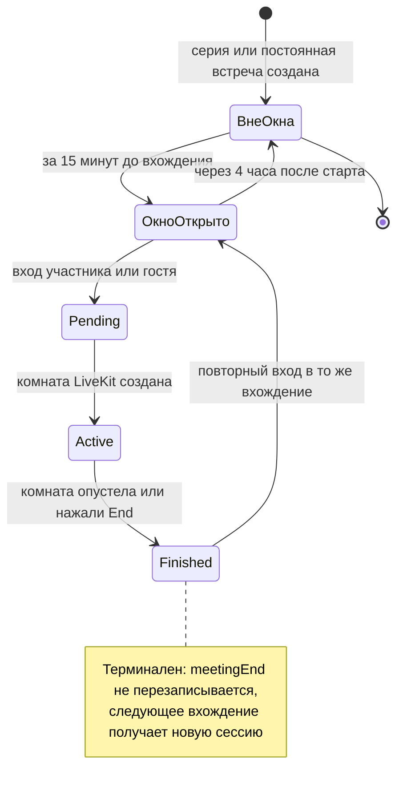

## 6. Модель: где живёт что

Что показывает: почему настройки встречи живут в миксине мастера, а время и участники — в событии.

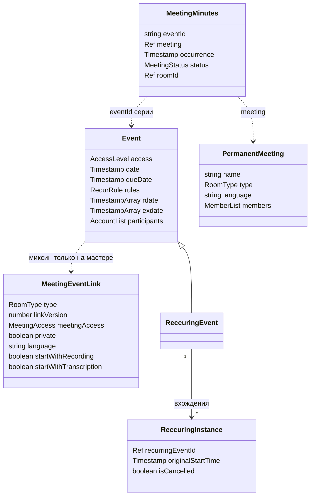

## 7. Навигатор офиса и адреса

Что показывает: что означает каждый URL-сегмент и куда ведёт выбор.

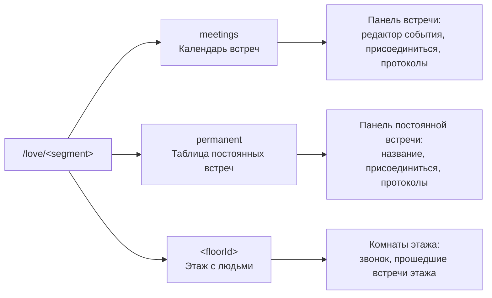

## 8. Риски этапов

Что показывает: где нужен запас по времени и предварительная проверка.

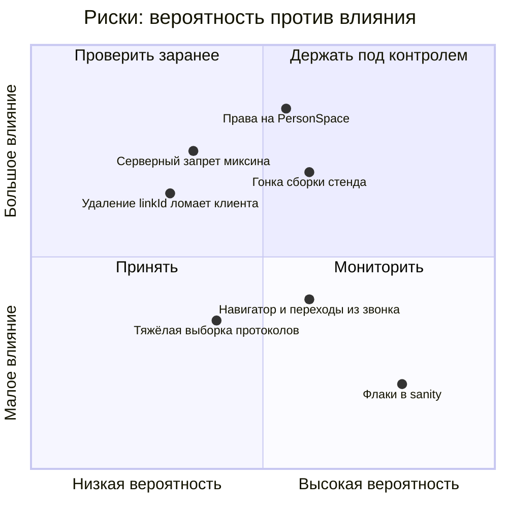

## 9. Зоны кода по этапам

Что показывает: какие каталоги трогает работа и где искать при отладке.

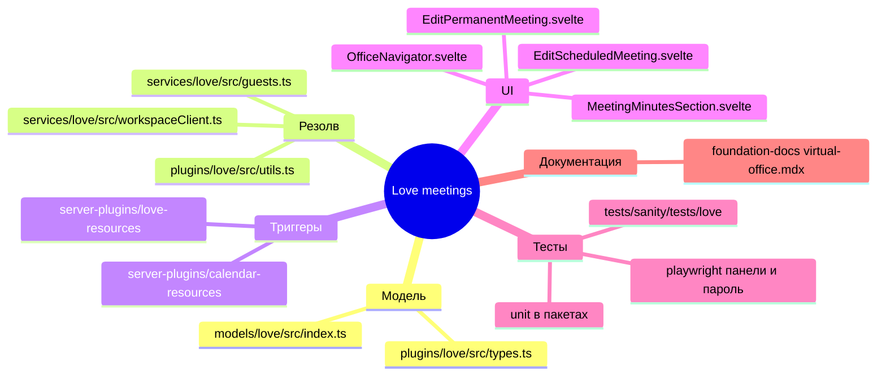

## 10. Внеплановый старт по ссылке (этап 5)

Что показывает: как решается вопрос «сейчас не время встречи, но я хочу подключиться» — и почему ссылка при этом не меняется.

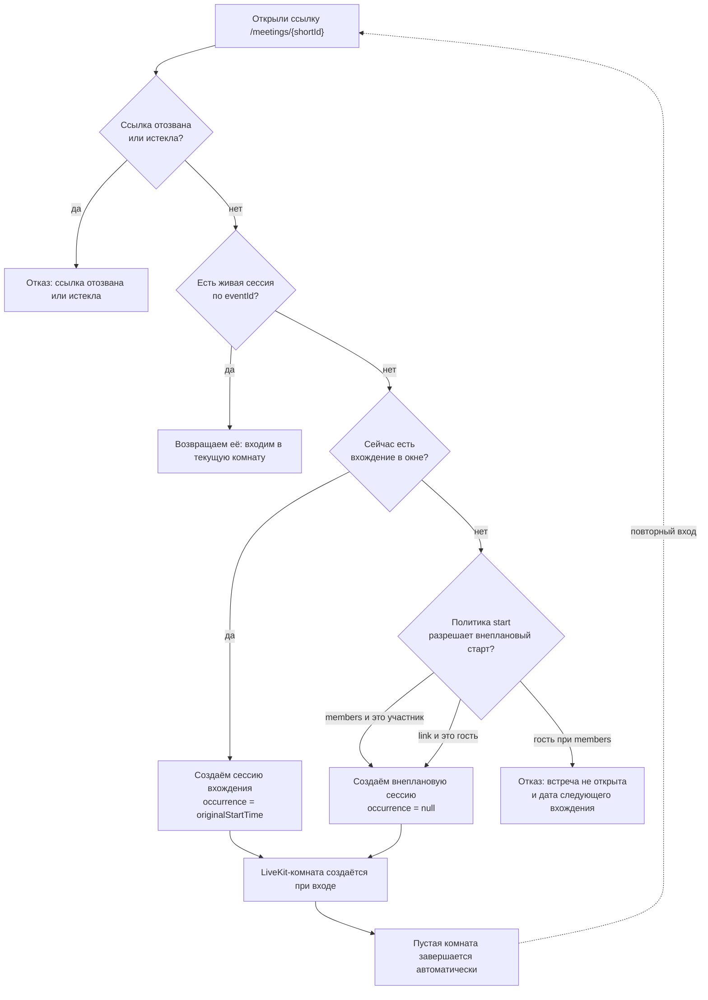

## 11. Гостевая ссылка всегда активна (выполнено в `FUSIO-1307-livekit-shared-link`)

Что показывает: что происходит при входе по ссылке после правки — встреча перезапускается, комната создаётся, `meetingId` и ссылка не меняются.

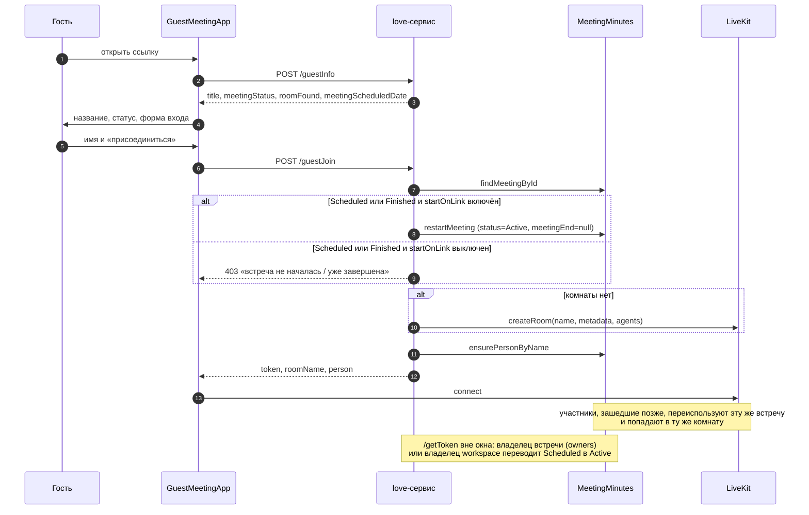

## 12. Создание встречи: два пути и связь между документами (2026-11-06)

Что показывает: какие документы появляются при создании встречи из формы события (реализовано) и из записи
планировщика (осталось), и кто на кого ссылается после того, как связь переехала в `permanentMeeting`.

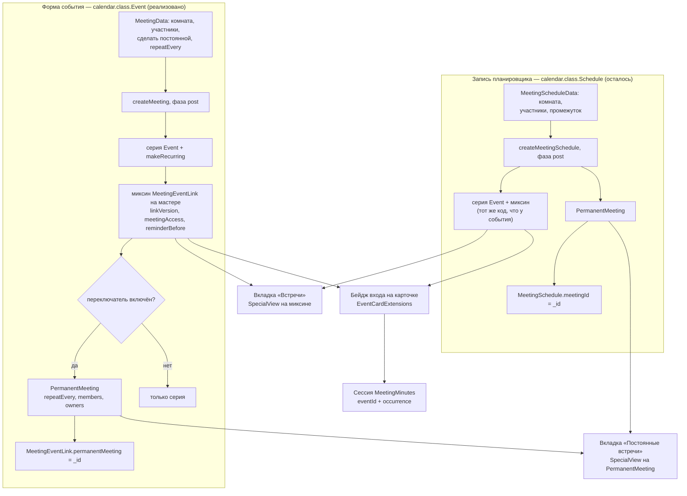

Почему так: миксин `MeetingEventLink` объявлен на `calendar.class.Event`, поэтому запись планировщика сама попасть
во вкладку «Встречи» не может — путь планировщика обязан создать серию событий. Ссылки две, каждая со своей стороны:
`MeetingEventLink.permanentMeeting` (серия → постоянная встреча) и `MeetingSchedule.meetingId`
(запись планировщика → постоянная встреча).

## 13. Правка и удаление регулярной встречи (2026-11-06)

Что показывает: что происходит с сессией при правке участников и при удалении серии.

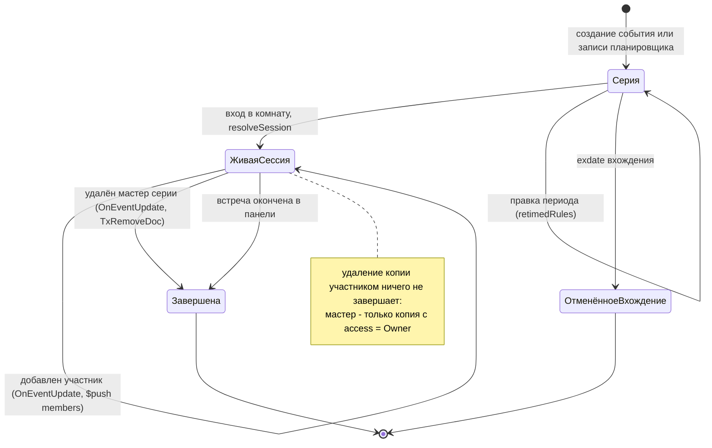
